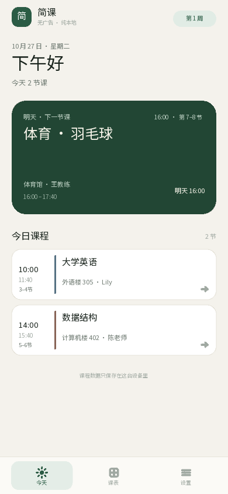
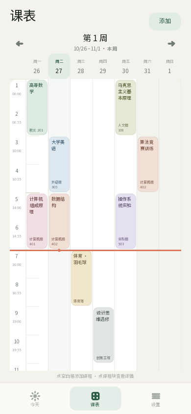
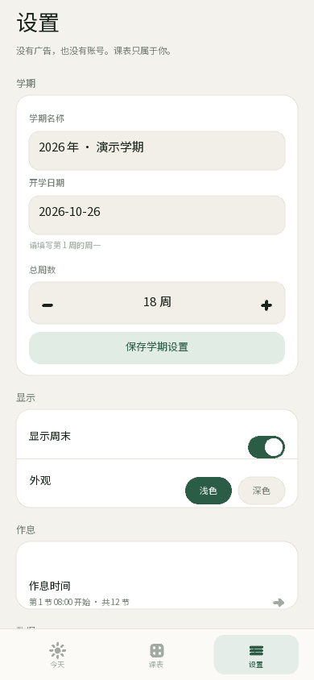
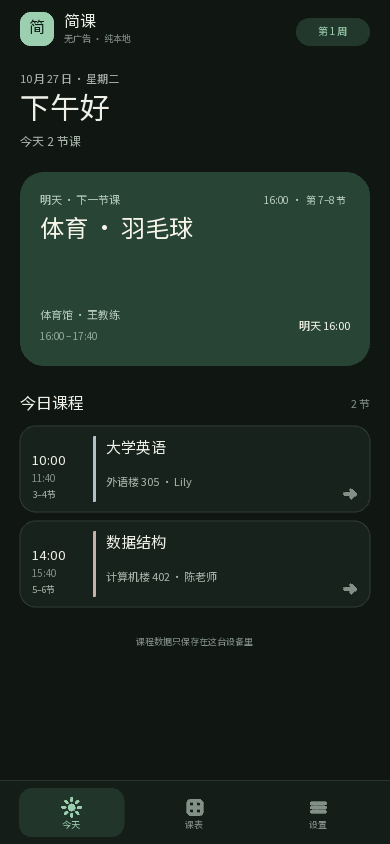
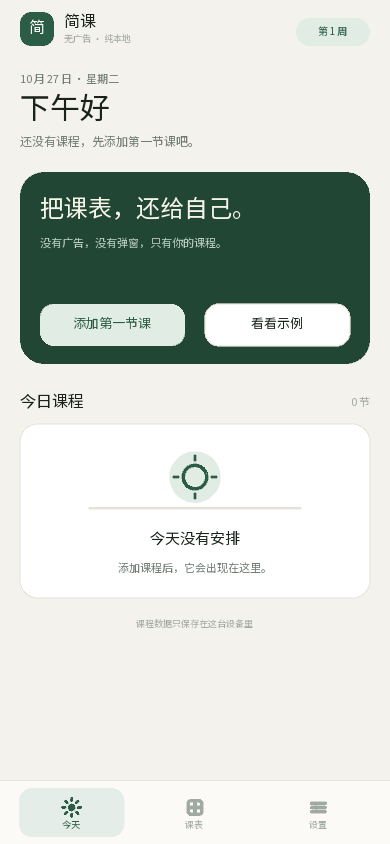

# 简课

> 一个没有广告、不用登录、数据只留在本机的安卓课程表。

用 Python + Kivy 写的课程表。目标很简单：把“看今天上什么课、下一节在哪”这件事做好，不塞开屏广告、不塞信息流、不要求注册账号。



| 周课表 | 设置 |
| --- | --- |
|  |  |

| 深色模式 | 第一次打开 |
| --- | --- |
|  |  |

## 功能

- **今日**：今天的课、正在上的课、下一节课、倒计时；没课时也会告诉你下一节是什么时候。
- **周课表**：7 天网格，可隐藏周末；点空白格直接加课，点课程块看详情；重叠课程会并排显示。
- **课程管理**：课程名、地点、老师、备注、颜色、星期、起止节次；支持每周 / 单周 / 双周 / 自定义周次（如 `1-8, 10, 12-16`）。
- **学期设置**：学期名、第 1 周周一、总周数；自动计算“第几周”。
- **作息时间**：12 节课的上下课时间都能改，首页倒计时和“下一节课”会跟着变。
- **深色模式**：浅色 / 深色一键切换，立即生效。
- **离线备份**：生成一串压缩备份码，复制到备忘录，换手机后粘贴恢复。不上传任何服务器。
- **示例课表**：第一次打开可以先载入演示数据，熟悉后再清空。
- **无广告、无账号、无联网权限**：不请求网络，不集成广告或统计 SDK。

## 在电脑上先跑起来

需要 Python 3.10+。

```bash
cd jianke
python -m venv .venv

# Windows PowerShell
.venv\Scripts\Activate.ps1

# macOS / Linux
# source .venv/bin/activate

pip install -r requirements.txt
python main.py
```

第一次启动是空课表。你可以：

1. 点「看看示例」快速看效果；或
2. 点「添加第一节课」开始填自己的课；
3. 到「设置 → 学期」把开学日期改成你学校第 1 周的周一。

### 测试

```bash
python -m unittest discover -s tests -v
```

15 个核心测试覆盖周次、单双周、时间判断、冲突检测、重叠布局、备份编码和本地存储。

`tools/ui_flow_test.py` 会打开桌面窗口，自动走一遍“加课 → 编辑 → 复制 → 删除 → 改学期 → 改作息 → 备份恢复”，属于开发自测，不是安装步骤。

## 打包成安卓 APK

> 简课用 Kivy + Buildozer。Buildozer 只能在 Linux（含 WSL2）里运行，**不能直接在 Windows 上跑**。当前开发环境是 Windows，没有安装 WSL / Android SDK，所以我没有在这里现场生成 APK；下面的 GitHub Actions 路径不需要你本地装 Android 工具链。

### 路线 A：GitHub Actions 一键打包（推荐）

1. 注册/登录 GitHub，新建一个空仓库（可以设为 Private）。
2. 在电脑上进入本项目根目录（能看到 `buildozer.spec` 的那一层），执行：

```bash
git init
git add .
git commit -m "简课 1.0"
git branch -M main
git remote add origin https://github.com/你的用户名/你的仓库.git
git push -u origin main
```

3. 打开仓库的 **Actions** 标签页，左侧选 **Build Android APK**，点 **Run workflow** → **Run workflow**。
4. 第一次构建会下载 Android SDK/NDK，通常 **30–60 分钟**。完成后在运行记录底部下载 `jianke-debug-apk` 压缩包，解压得到 `.apk`。
5. 把 APK 发到手机安装。Android 会提示“未知来源应用”，允许当前文件管理器安装即可。

> `.github` 是隐藏文件夹。用网页拖拽上传时可能漏掉它，建议用上面的 git 命令或 GitHub Desktop 上传整个目录。

工作流会生成 `arm64-v8a` 的 **debug APK**，可以直接安装，但不是应用商店签名版。如果要上架，需要自己生成 release keystore 并改用 `buildozer android release`。

### 路线 B：Windows WSL2 / Ubuntu 本地打包

先装 WSL2 和 Ubuntu（管理员 PowerShell）：

```powershell
wsl --install -d Ubuntu
```

进入 Ubuntu 后：

```bash
sudo apt update
sudo apt install -y python3 python3-pip openjdk-17-jdk git zip unzip \
  autoconf automake libtool pkg-config zlib1g-dev \
  libncurses5-dev libncursesw5-dev cmake libffi-dev libssl-dev
```

在 WSL 里进入项目目录并构建：

```bash
cd /mnt/c/你的路径/jianke
chmod +x scripts/build_android.sh
./scripts/build_android.sh
```

APK 会出现在 `bin/`。第一次构建同样需要下载 SDK/NDK，建议预留约 10 GB 磁盘。更完整的 Buildozer 依赖说明见官方文档：<https://buildozer.readthedocs.io>。

### 只想要 32 位老手机？

编辑 `buildozer.spec`：

```ini
android.archs = arm64-v8a, armeabi-v7a
```

构建时间会长一些。

## 数据、隐私和备份

- 数据保存在应用私有目录的 `jianke-data.json`。安卓上其他应用无法直接读取；Windows 下通常在 `%APPDATA%\jianke`。
- 写入使用“临时文件 + 原子替换”，写到一半被系统杀掉也不会留下半个 JSON。
- App 不申请 `INTERNET` 权限，没有账号、广告、统计或云同步。
- 换手机 / 刷机前：**设置 → 备份与恢复 → 复制备份码**，把备份码保存到备忘录。
- 恢复会覆盖当前课表，页面会二次确认。
- 备份码里可能包含老师姓名、教室，分享前请确认。
- 删掉 App 会连同本地课表一起删除，系统不会自动帮你备份。

## 代码结构

```text
main.py                     启动入口（桌面窗口尺寸 + 启动 Kivy）
jianke_app/
  core.py                   数据模型、周次/单双周、今天/下一节、冲突与重叠布局
  storage.py                本地 JSON 原子读写、损坏文件留档
  theme.py                  浅色/深色调色板、字体注册
  widgets.py                自绘卡片、按钮、输入框、图标、弹窗、Toast
  base.py                   页面基类、顶部返回栏
  home.py                   今日页 + 下一节课卡片 + 倒计时
  week.py                   周课表网格、课程块、当前时间线
  editor.py                 添加/编辑课程
  detail.py                 课程详情、复制/删除
  settings.py               学期、显示、作息、数据管理
  periods.py                12 节作息时间编辑
  backup.py                 备份码复制/恢复
  app.py                    导航、主题切换、Android 返回键、全局状态
assets/                     图标、启动图、Noto Sans SC 字体和 OFL 许可
buildozer.spec              Android 打包配置
.github/workflows/          GitHub Actions 自动构建 APK
scripts/build_android.sh    WSL/Linux 构建脚本
tests/test_core.py          不依赖界面的核心逻辑测试
tools/preview.py            开发用截图脚本（不属于 App）
```

### 一段话说明代码是怎么跑起来的

`main.py` 启动 `JianKeApp`，先把 `assets/fonts` 里的中文字体注册给 Kivy，再从应用私有目录读取 JSON（没有就新建默认学期），随后创建底部导航和今日/周课表/设置三个主页面；所有“今天第几周、这门课本周上不上、现在正在上哪节、下一节是什么时候”的判断都在 `core.py` 里完成，界面只负责把结果画出来。周课表用 Kivy 的 Canvas 自绘背景和课程块，`overlap_layout()` 会把同一天时间重叠的课程并排；添加/编辑课程时，`Course` 会校验字段，`conflict_weeks()` 检查周次与节次冲突，保存后 `Storage` 先写临时文件再原子替换，保证课表不会写坏。备份码则是把 `AppData` 转成 JSON，经 zlib 压缩、base64 编码，再带一段 SHA-256 校验；恢复时校验并重建数据。换主题时会重建界面组件，让所有 Canvas 颜色立即更新；安卓端由 Buildozer 把 Python 运行时、Kivy、字体和资源一起打成 APK，所以手机端不需要另外安装 Python。

## 一些设计取舍（v1）

- **没有做系统级上课推送**。做可靠的安卓定时通知需要 `AlarmManager`、通知权限、开机自启和厂商后台限制适配，测试成本高；首版用首页“下一节 + 倒计时”替代，不额外申请权限、不常驻后台。后续可以在不改数据模型的前提下加本地通知。
- **固定 12 节课**，但每节的开始/结束时间可在设置里自由修改。这样课表格子高度稳定，符合大多数国内高校作息。
- **一条课程记录 = 一个固定时间段**。同一门课一周上两次时，在课程详情里点「再排一节同样的课」，改一下星期/节次即可。
- **没有做截图 OCR / 超级课程表导入 / 云同步**。这些都是重功能，容易引入联网、权限和准确性问题；首版坚持纯本地、可解释。
- **APK 只打 arm64**，以缩短构建时间和体积。2019 年后的安卓手机基本都是 64 位。

## 想自己改

- 改 App 名字：`jianke_app/app.py` 的 `title`，以及 `buildozer.spec` 的 `title`。
- 改主题色：`jianke_app/theme.py` 的 `LIGHT`、`DARK`、`COURSE_COLORS`。
- 改默认作息：`jianke_app/core.py` 的 `DEFAULT_PERIOD_TIMES`。
- 改字体：替换 `assets/fonts/NotoSansSC-Regular.ttf`，保留文件名即可；注意字体许可证。

## 许可

- 代码：MIT License，见 [LICENSE](LICENSE)。
- 字体：Noto Sans SC，SIL Open Font License 1.1，见 [assets/fonts/OFL.txt](assets/fonts/OFL.txt)。
- 图标和启动图由本项目用同一字体生成。

“简课”是一个独立的小项目，和超级课程表没有关联。超级课程表是别人的产品，这里只是做一个更安静的替代品。
